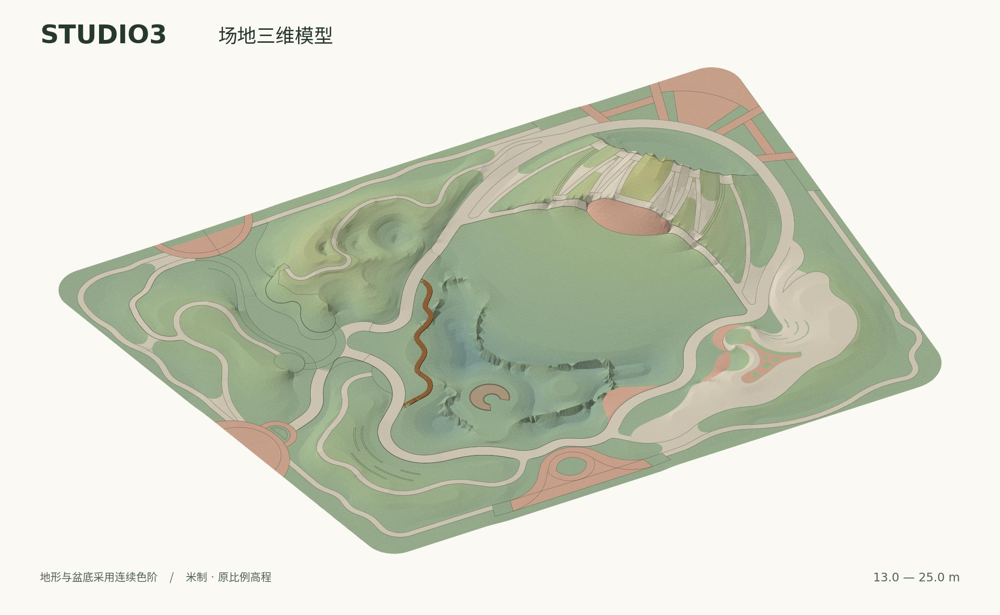

# STUDIO3 景观三维模型

[下载完整模型包](./STUDIO3-landscape.zip?raw=true)

| 文件 | 编辑用途 | 单位 |
| --- | --- | --- |
| STUDIO3-m.3dm | Rhino 7 及以上版本。按图层编辑地形、园路、铺装、建筑基底、桥体及曲线 | 米 |
| STUDIO3-mm.dxf | AutoCAD 2013 DXF。地表为原生 MESH，可与源 DWG 按原点叠合 | 毫米 |
| STUDIO3-m.dae | SketchUp 等支持 COLLADA 的软件。按对象和材质导入表面网格 | 米 |

压缩包内附中文说明，列出高程依据、桥面竖向调整和校核结果。
